# Hi, I'm wzk0 👋

### Developer · Open Source Enthusiast · Linux Explorer

热爱编程，喜欢探索技术背后的原理，也喜欢把想法变成真正可用的软件。

专注于 Flutter 应用开发、Android 系统探索与 Linux 自动化工具，享受从应用界面到系统底层的开发过程。

**Stay curious. Keep building. Keep exploring.**

---

## 👨‍💻 About Me

- 📱 Interested in Android development and modern UI design.
- 🎨 Building applications with Flutter, Jetpack Compose and Material Design 3.
- 🐧 Linux enthusiast, exploring desktop environments and system internals.
- ⚙️ Working on Android kernel and Linux RootFS automation.
- 🤖 Interested in AI Agents, MCP and automation workflows.
- 🌱 Always learning something new and turning ideas into projects.

## 🛠️ Tech Stack

**Programming Languages**

**Frameworks & Platforms**

**Tools & Technologies**

---

## 🚀 Featured Projects

### 📱 [new_zhic_tool](https://github.com/wzk0/new_zhic_tool) — 掌环

Flutter · Dart · Riverpod · Material 3 Expressive

面向天津理工大学中环信息学院的校园综合助手，将教务查询、学习资料与常用校园服务整合到一个应用中。

- 📚 课表、成绩、考试安排、培养方案查询
- 🏫 空教室查询与校园服务入口
- 📝 期末题库共享与社区共建
- 🎨 Material 3 Expressive、动态取色与自定义主题
- 🔄 本地缓存、账号管理与自动更新
- ⚙️ GitHub Actions 自动构建和发布 APK

### 🔢 [Counter](https://github.com/wzk0/Counter)

Kotlin · Jetpack Compose · Material 3 Expressive

一个原生 Android 多计数器应用，采用 Jetpack Compose 构建，支持 Android Monet 动态取色。

- 多个独立计数器同时运行
- 宽松 / 紧凑两种列表布局
- 左滑删除、右滑置顶
- 长按连续增加或减少
- 计数历史与本地持久化
- 深色模式与动态主题

### 🖥️ [Droidspaces-rootfs-Desktop-builder](https://github.com/wzk0/Droidspaces-rootfs-Desktop-builder)

Linux · Fedora · GNOME · Docker · Shell · GitHub Actions

为 Android 上的 Droidspaces 构建 Fedora 45 + GNOME 51 桌面 Linux 环境，让 Android 设备也能运行完整的 Linux 桌面。

- Fedora 45 ARM64 RootFS 自动构建
- GNOME 51 + Anland Wayland 桌面环境
- Snapdragon GPU 硬件加速与视频解码支持
- Chrome、Fcitx5 中文输入法及开发工具
- Docker、USB 管理与容器内 TUI 工具
- GitHub Actions 自动构建和 Release 发布

### ⚙️ [marble-kernel-builder](https://github.com/wzk0/marble-kernel-builder)

Android Kernel · Shell · GitHub Actions · KernelSU · SUSFS

面向 POCO F5 / Redmi Note 12 Turbo（marble / marblein）的 Android 内核自动化构建系统。

- 支持 5 种上游内核源码
- 支持 KernelSU、KernelSU-Next、SukiSU Ultra、ReSukiSU
- 可选 SUSFS 与 Droidspaces 内核补丁
- 多工具链管理与版本固定
- LTO、ccache、ThinLTO 缓存优化
- 自动化构建矩阵、测试、产物审计与 Release 管理
- 通过 GitHub Actions 实现多配置并行构建

---

## 📊 GitHub Statistics

## 📊 GitHub Statistics

  
  

## 📈 Contribution Activity

---

## 🌐 Find Me

- GitHub: [@wzk0](https://github.com/wzk0)
- Gitee: [@thdbd](https://gitee.com/thdbd)

---

**Thanks for stopping by! ⭐**

*Build useful things. Explore the unknown.*

